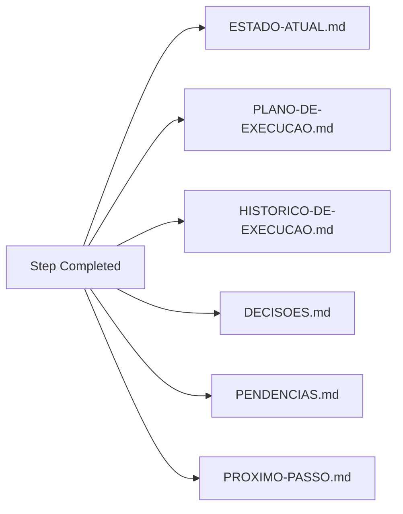

# How AGIM Works

> Architecture, orchestration flow, and skills system in detail.

---

## Architectural Overview

```
┌─────────────────────────────────────────────────────────────────┐
│                        AGIM ORCHESTRATOR                        │
├─────────────────────────────────────────────────────────────────┤
│                                                                 │
│  ┌──────────────────┐    ┌──────────────────┐                 │
│  │   USER GOAL      │───▶│ ENTREVISTA       │                 │
│  │ "New feature"    │    │ ORCHESTRATOR     │                 │
│  └──────────────────┘    └────────┬─────────┘                 │
│                                   │                           │
│               ┌───────────────────┼───────────────────┐       │
│               ▼                   ▼                   ▼       │
│    ┌─────────────────┐  ┌─────────────────┐  ┌─────────────┐  │
│    │ CLASSIFICATION  │  │ SKILL SELECTION │  │ PLANNING      │  │
│    │ domain/type/    │  │ MINIMAL SKILLS  │  │ WITH ACCEPTANCE│ │
│    │ complexity/     │  │ (12 core + 2    │  │ CRITERIA      │  │
│    │ risk/scope      │  │  extended)      │  │              │  │
│    └─────────────────┘  └─────────────────┘  └─────────────┘  │
│               │                   │                   │         │
│               └───────────────────┼───────────────────┘         │
│                                   ▼                             │
│                    ┌─────────────────────────┐                 │
│                    │   PARALLEL EXECUTION    │                 │
│                    │  With per-step verify   │                 │
│                    └───────────┬─────────────┘                 │
│                                │                               │
│                                ▼                               │
│                    ┌─────────────────────────┐                 │
│                    │ MANDATORY QUALITY GATE  │                 │
│                    │ tests + build + lint    │                 │
│                    │ + type-check + evidence │                 │
│                    └───────────┬─────────────┘                 │
│                                │                               │
│                                ▼                               │
│                    ┌─────────────────────────┐                 │
│                    │ 6-AXIS CODE REVIEW      │                 │
│                    │ Works  │ Readable       │                 │
│                    │ Secure │ Performant     │                 │
│                    │ Testable│ Consistent    │                 │
│                    └───────────┬─────────────┘                 │
│                                │                               │
│                                ▼                               │
│                    ┌─────────────────────────┐                 │
│                    │ FINAL REVIEW (DoD)      │                 │
│                    │ Criteria │ Git │ Tests │                 │
│                    │ Build    │ Docs│ Pending│                 │
│                    └───────────┬─────────────┘                 │
│                                │                               │
│                                ▼                               │
│                    ┌─────────────────────────┐                 │
│                    │ RECORDS IN MEMORIA/     │                 │
│                    │ 6 persistent files      │                 │
│                    └─────────────────────────┘                 │
│                                                                 │
└─────────────────────────────────────────────────────────────────┘
```

---

## The Central Orchestrator: `entrevista-orquestradora`

This is the **only skill you should invoke manually** (or let CLI do via `agim auto` / `agim interview`). It:

### 1. Understands the Request
- Adaptive interview (only critical questions affecting the solution)
- Reaches ~95% confidence on true intent

### 2. Classifies the Task
| Dimension | Possible Values |
|-----------|-----------------|
| **Domain** | web, mobile, api, cli, data, infra, security, docs |
| **Type** | feature, bugfix, refactor, audit, review, setup, research |
| **Complexity** | trivial, low, medium, high, critical |
| **Risk** | low, medium, high, critical |
| **Scope** | file, module, feature, system, cross-cutting |

### 3. Consults the Bible Index
- `INDEX.md` → navigation map
- `ORCHESTRATOR.md` → skills/MCPs/tools routing
- `SKILLS-CATALOG.md` → complete catalog (11 fields per skill)
- `SKILLS-SELECTION-MATRIX.md` → intent → competency matrix

### 4. Discovers Real Context
- Inspects relevant files
- Checks Git status
- Reads `memoria/` (state, plan, decisions, pending)

### 5. Selects Minimal Skills/MCPs/Tools
Uses selection matrix to choose only what's needed:

| Scenario | Required Skills | Optional Skills |
|----------|-----------------|-----------------|
| **New Web Feature** | interview → planning → spec-driven → tests → verification → review | security-audit, code-review |
| **Bug Fix** | systematic-debugging → testes-com-roteiro → verification → review | code-simplification |
| **Refactoring** | analise-de-legado → code-simplification → tests → verification → review | code-review |
| **New UI** | interview → revisao-de-interface → tests (a11y) → verification → review | spec-driven |
| **Security Audit** | auditoria-de-seguranca → tests (sec) → verification → review | systematic-debugging |
| **Code Review** | code-review-and-quality → verification → review | systematic-debugging |

### 6. Prepares Proportional Plan
- Verifiable steps with clear acceptance criteria
- Dependencies identified
- Risks mapped
- Effort estimated

### 7. Executes/Coordinates with Per-Step Verification
- Independent tasks → parallel
- Sequential tasks → in order
- After each step: validation + `memoria/` update

### 8. Verifies Final Result vs Original Criteria
- `verification-before-completion` (mandatory)
- `code-review-and-quality` (6 axes)
- `revisao-final` (final quality gate)

### 9. Records Complete Continuity
Updates all 6 `memoria/` files

---

## Persistent Memory System (`memoria/`)

### Update Flow (After EVERY Significant Step)



### Each File Structure

#### `ESTADO-ATUAL.md`
```markdown
# Current State
- **Phase**: implementation
- **Last Validation**: 2026-10-29 14:30 - unit tests passed
- **Next Step**: implement POST /users endpoint
- **Modified Files**: src/routes/users.routes.ts, src/services/users.service.ts
- **Tests Run**: unit (12/12 pass), integration (0/3)
- **Problems**: None
- **Blockers**: Awaiting PR #42 review
- **Recent Decisions**: Use Argon2id for hashing (DEC-001)
- **Pending**: Implement custom rate limiting
```

#### `PLANO-DE-EXECUCAO.md`
```markdown
# Execution Plan

## Phase 1: Setup and Spec
- [x] 1.1 Detect stack and install kit (DONE)
- [x] 1.2 Interview and classification (DONE)
- [x] 1.3 Functional specification (DONE)

## Phase 2: Backend Implementation
- [x] 2.1 Create Prisma schema (DONE)
- [ ] 2.2 Implement repository (IN PROGRESS)
- [ ] 2.3 Implement service (NOT STARTED)
- [ ] 2.4 Implement controller (NOT STARTED)
- [ ] 2.5 Implement routes (NOT STARTED)
- [ ] 2.6 Zod validations (NOT STARTED)

## Phase 3: Tests and Validation
- [ ] 3.1 Unit tests (NOT STARTED)
- [ ] 3.2 Integration tests (NOT STARTED)
- [ ] 3.3 Quality gate (NOT STARTED)
```

#### `PROXIMO-PASSO.md` (Most Critical for Resumption)
```markdown
# Next Executable Step

## Where to Resume
**File**: `src/repositories/users.repository.ts`
**Line**: 45 (incomplete `listar` method)

## Action
Complete `listar` method with pagination and search:
```typescript
async listar(filtros: ListarUsuariosFiltros) {
  const { pagina, limite, busca } = filtros;
  const skip = (pagina - 1) * limite;
  const where = busca ? { OR: [...] } : {};
  const [dados, total] = await Promise.all([
    this.prisma.usuario.findMany({ where, skip, take: limite, orderBy: { criadoEm: 'desc' } }),
    this.prisma.usuario.count({ where })
  ]);
  return { dados, paginacao: { pagina, limite, total, totalPaginas: Math.ceil(total / limite) } };
}
```

## Dependencies
- Prisma schema already created and migrated
- `PrismaService` injected in constructor

## Validation
- Run `npm test -- users.repository.test.ts`
- Verify paginated data returned correctly

## Fallback
If stuck: consult `exemplos/arquitetura-modular/backend/src/repositories/usuarios.repository.ts`
```

---

## Skills Pipeline (Detailed)

### Phase 1: Discovery and Planning
```
"New feature: blog with markdown"
         │
         ▼
┌─────────────────────┐
│ entrevista-orquestradora                          │
│ • Classifies: web, feature, media, medium, blog  │
│ • Selects: planning + spec-driven + tests        │
│   + audit + review                               │
└────────┬────────────┘
         │
         ▼
┌─────────────────────┐   ┌─────────────────────┐   ┌─────────────────┐
│ spec-driven-dev     │   │ planejamento-tarefas │   │ auditoria-seg   │
│ (spec-first + TDD)  │   │ (12 steps, 3 phases) │   │ (checklist)     │
└────────┬────────────┘   └────────┬────────────┘   └────────┬────────┘
         │                       │                       │
```

### Phase 2: Parallel Implementation
```
┌─────────────────────────────────────────────────────────────────┐
│                    PARALLEL IMPLEMENTATION                      │
│  code-simplification (refactoring)  │  testes-com-roteiro       │
│  spec-driven impl (TDD loop)        │  (unit + int + e2e + a11y) │
└────────────────────────┬────────────────────────────────────────┘
                         │
```

### Phase 3: Quality Gates
```
                         ▼
┌─────────────────────────────────────────────────────────────────┐
│              verification-before-completion                     │
│  tests + build + lint + type-check + validations + evidence     │
└────────────────────────┬────────────────────────────────────────┘
                         │
                         ▼
┌─────────────────────────────────────────────────────────────────┐
│              code-review-and-quality (6 axes)                   │
│  Works │ Readable │ Secure │ Performant │ Testable │ Consistent │
└────────────────────────┬────────────────────────────────────────┘
                         │
                         ▼
┌─────────────────────────────────────────────────────────────────┐
│              revisao-final (Final Quality Gate)                 │
│  Criteria │ Git │ Tests │ Build │ Docs │ Pending                │
└─────────────────────────────────────────────────────────────────┘
```

---

## Integration with MCPs and External Tools

### Context7 (Mandatory for Libraries)
```bash
# Mandatory flow when using any library:
1. Identify lib (e.g., React, Prisma, Zod, Vitest)
2. Check version in project's package.json
3. context7 resolve-library-id "library name"
4. context7 query-docs "specific question" --libraryId "/org/lib@version"
5. Confirm real version in docs
6. Implement following official docs
7. Record decision in DECISOES.md
```

### GitHub MCP
- Releases, tags, teams, issues, PRs
- Used for: repo validation, changelog, issues

### Browser/Playwright MCP
- Real browser automation
- Screenshots, E2E, visual validation
- Used by: `revisao-de-interface`, `testes-com-roteiro` (e2e/a11y)

### Graphify (Lazy)
- Code knowledge graph
- Natural queries → relevant subgraph (~2KB vs 200KB)
- Loaded on demand by `graphify-integration`

### Bible RAG (Lazy)
- Semantic search in AGIM
- Relevant chunks (~2KB vs 27KB full doc)
- Loaded on demand by `bible-rag-search`

---

## Mandatory Execution Protocol

### Session Start (ALWAYS)
```bash
1. skill entrevista-orquestradora          # ALWAYS FIRST
2. Read memoria/ESTADO-ATUAL.md
3. Read memoria/PROXIMO-PASSO.md
4. Consult memoria/PLANO-DE-EXECUCAO.md
5. Consult memoria/DECISOES.md + PENDENCIAS.md
6. Inspect real state (files + Git)
7. Compare documented vs real
8. Identify divergences
9. Report resumption point
10. Continue WITHOUT repeating completed tasks
```

### During Execution (After EVERY Step)
- Update `ESTADO-ATUAL.md`
- Update `PLANO-DE-EXECUCAO.md` (step status)
- Record decisions in `DECISOES.md`
- Record pending in `PENDENCIAS.md`
- Record evidence in `HISTORICO-DE-EXECUCAO.md`
- Update `PROXIMO-PASSO.md`

### Interruption/Shutdown (ALWAYS)
- Save complete state
- Record last validated point
- Identify untested changes
- Record blockers
- Update `PROXIMO-PASSO.md`
- **DO NOT declare completion** with pending criteria

---

## Recovery After Context Loss

```markdown
IF agent doesn't know where it stopped:
1. DO NOT invent history
2. DO NOT ask for info recoverable from files
3. Consult persistent records (memoria/)
4. Inspect Git and affected files
5. Reconstruct state from evidence
6. Identify conflicts
7. Fix records when needed
8. Resume from safe point

IF uncertainty with risk of loss/damage: INTERRUPT and ask for clarification.
```

---

## Next Documents

| Document | Focus |
|----------|-------|
| [SKILLS-SYSTEM.md](./SKILLS-SYSTEM.md) | Complete 14 skills reference |
| [QUICKSTART.md](./QUICKSTART.md) | Zero to `agim auto` in 5 min |
| [CLI-REFERENCE.md](./CLI-REFERENCE.md) | 14 commands with examples |
| [ARCHITECTURE.md](./ARCHITECTURE.md) | 9 backend layers + 6 frontend |