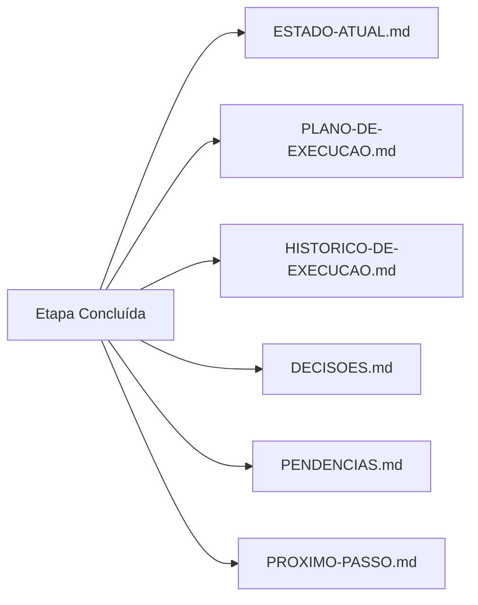

# Como o AGIM Funciona

> Arquitetura, fluxo de orquestração e sistema de skills em detalhes.

---

## Visão Arquitetural

```
┌─────────────────────────────────────────────────────────────────┐
│                        AGIM ORCHESTRATOR                        │
├─────────────────────────────────────────────────────────────────┤
│                                                                 │
│  ┌──────────────────┐    ┌──────────────────┐                 │
│  │   USER GOAL      │───▶│ ENTREVISTA       │                 │
│  │ "Nova feature"   │    │ ORQUESTRADORA    │                 │
│  └──────────────────┘    └────────┬─────────┘                 │
│                                   │                           │
│               ┌───────────────────┼───────────────────┐       │
│               ▼                   ▼                   ▼       │
│    ┌─────────────────┐  ┌─────────────────┐  ┌─────────────┐  │
│    │ CLASSIFICAÇÃO   │  │ SELEÇÃO DE      │  │ PLANEJAMENTO  │  │
│    │ domínio/tipo/   │  │ SKILLS MÍNIMAS  │  │ COM CRITÉRIOS │  │
│    │ complexidade/   │  │ (12 core + 2    │  │ DE ACEITAÇÃO  │  │
│    │ risco/escopo    │  │  extended)      │  │              │  │
│    └─────────────────┘  └─────────────────┘  └─────────────┘  │
│               │                   │                   │         │
│               └───────────────────┼───────────────────┘         │
│                                   ▼                             │
│                    ┌─────────────────────────┐                 │
│                    │   EXECUÇÃO PARALELA     │                 │
│                    │  Com verificação/etapa  │                 │
│                    └───────────┬─────────────┘                 │
│                                │                               │
│                                ▼                               │
│                    ┌─────────────────────────┐                 │
│                    │ QUALITY GATE OBRIGATÓRIO│                 │
│                    │ testes + build + lint   │                 │
│                    │ + type-check + evidência│                 │
│                    └───────────┬─────────────┘                 │
│                                │                               │
│                                ▼                               │
│                    ┌─────────────────────────┐                 │
│                    │ CODE REVIEW 6 EIXOS     │                 │
│                    │ Funciona │ Legível      │                 │
│                    │ Seguro   │ Performático │                 │
│                    │ Testável │ Consistente  │                 │
│                    └───────────┬─────────────┘                 │
│                                │                               │
│                                ▼                               │
│                    ┌─────────────────────────┐                 │
│                    │ REVISÃO FINAL (DoD)     │                 │
│                    │ Critérios │ Git │ Testes│                 │
│                    │ Build     │ Docs│ Pendên│                 │
│                    └───────────┬─────────────┘                 │
│                                │                               │
│                                ▼                               │
│                    ┌─────────────────────────┐                 │
│                    │ REGISTRA EM MEMORIA/    │                 │
│                    │ 6 arquivos persistentes │                 │
│                    └─────────────────────────┘                 │
│                                                                 │
└─────────────────────────────────────────────────────────────────┘
```

---

## A Orquestradora Central: `entrevista-orquestradora`

Esta é a **única skill que você deve invocar manualmente** (ou deixar o CLI fazer via `agim auto` / `agim interview`). Ela:

### 1. Entende o Pedido
- Faz entrevista adaptativa (apenas perguntas críticas que afetam a solução)
- Alcança ~95% de confiança sobre a intenção real

### 2. Classifica a Tarefa
| Dimensão | Valores Possíveis |
|----------|-------------------|
| **Domínio** | web, mobile, api, cli, data, infra, security, docs |
| **Tipo** | feature, bugfix, refactor, audit, review, setup, research |
| **Complexidade** | trivial, baixa, média, alta, crítica |
| **Risco** | baixo, médio, alto, crítico |
| **Escopo** | arquivo, módulo, feature, sistema, cross-cutting |

### 3. Consulta o Índice da Bíblia
- `INDEX.md` → mapa de navegação
- `ORCHESTRATOR.md` → roteamento skills/MCPs/ferramentas
- `SKILLS-CATALOG.md` → catálogo completo (11 campos por skill)
- `SKILLS-SELECTION-MATRIX.md` → matriz intenção → competências

### 4. Descobre Contexto Real
- Inspeciona arquivos relevantes
- Verifica Git status
- Lê `memoria/` (estado, plano, decisões, pendências)

### 5. Seleciona Skills/MCPs/Ferramentas Mínimas
Usa a matriz de seleção para escolher apenas o necessário:

| Cenário | Skills Obrigatórias | Skills Opcionais |
|---------|---------------------|------------------|
| **Nova Feature Web** | entrevista → planejamento → spec-driven → testes → verification → revisao | auditoria-seg, code-review |
| **Bug Fix** | systematic-debugging → testes-com-roteiro → verification → revisao | code-simplification |
| **Refatoração** | analise-de-legado → code-simplification → testes → verification → revisao | code-review |
| **Nova UI** | entrevista → revisao-de-interface → testes (a11y) → verification → revisao | spec-driven |
| **Auditoria Seg** | auditoria-de-seguranca → testes (sec) → verification → revisao | systematic-debugging |
| **Code Review** | code-review-and-quality → verification → revisao | systematic-debugging |

### 6. Prepara Plano Proporcional
- Etapas verificáveis com critérios de aceitação claros
- Dependências identificadas
- Riscos mapeados
- Estimativa de esforço

### 7. Executa/Coordena com Verificação por Etapa
- Tarefas independentes → paralelas
- Tarefas sequenciais → em ordem
- Após cada etapa: validação + atualização `memoria/`

### 8. Verifica Resultado Final vs Critérios Originais
- `verification-before-completion` (obrigatório)
- `code-review-and-quality` (6 eixos)
- `revisao-final` (quality gate final)

### 9. Registra Continuidade Completa
Atualiza todos os 6 arquivos de `memoria/`

---

## Sistema de Memória Persistente (`memoria/`)

### Fluxo de Atualização (Após CADA Etapa Significativa)



### Estrutura de Cada Arquivo

#### `ESTADO-ATUAL.md`
```markdown
# Estado Atual
- **Fase**: implementation
- **Última Validação**: 2026-10-29 14:30 - testes unitários passaram
- **Próxima Etapa**: implementar endpoint POST /usuarios
- **Arquivos Modificados**: src/routes/usuarios.routes.ts, src/services/usuarios.service.ts
- **Testes Rodados**: unit (12/12 pass), integration (0/3)
- **Problemas**: Nenhum
- **Bloqueios**: Aguardando revisão de PR #42
- **Decisões Recentes**: Usar Argon2id para hash (DEC-001)
- **Pendências**: Implementar rate limiting customizado
```

#### `PLANO-DE-EXECUCAO.md`
```markdown
# Plano de Execução

## Fase 1: Setup e Spec
- [x] 1.1 Detectar stack e instalar kit (CONCLUÍDA)
- [x] 1.2 Entrevista e classificação (CONCLUÍDA)
- [x] 1.3 Especificação funcional (CONCLUÍDA)

## Fase 2: Implementação Backend
- [x] 2.1 Criar schema Prisma (CONCLUÍDA)
- [ ] 2.2 Implementar repository (EM ANDAMENTO)
- [ ] 2.3 Implementar service (NÃO INICIADA)
- [ ] 2.4 Implementar controller (NÃO INICIADA)
- [ ] 2.5 Implementar routes (NÃO INICIADA)
- [ ] 2.6 Validações Zod (NÃO INICIADA)

## Fase 3: Testes e Validação
- [ ] 3.1 Testes unitários (NÃO INICIADA)
- [ ] 3.2 Testes integração (NÃO INICIADA)
- [ ] 3.3 Quality gate (NÃO INICIADA)
```

#### `PROXIMO-PASSO.md` (O Mais Importante Para Retomada)
```markdown
# Próximo Passo Executável

## Onde Retomar
**Arquivo**: `src/repositories/usuarios.repository.ts`
**Linha**: 45 (método `listar` incompleto)

## Ação
Completar implementação do método `listar` com paginação e busca:
```typescript
async listar(filtros: ListarUsuariosFiltros) {
  const { pagina, limite, busca } = filtros;
  const skip = (pagina - 1) * limite;
  const where = busca ? { OR: [...] } : {};
  const [dados, total] = await Promise.all([
    this.prisma.usuario.findMany({ where, skip, take: limite, orderBy: { criadoEm: 'desc' } }),
    this.prisma.usuario.count({ where })
  ]);
  return { dados, paginacao: { pagina, limite, total, totalPaginas: Math.ceil(total / limite) } };
}
```

## Dependências
- Schema Prisma já criado e migrado
- `PrismaService` injetado no construtor

## Validação
- Rodar `npm test -- usuarios.repository.test.ts`
- Verificar se retorna dados paginados corretos

## Fallback
Se travar: consultar `exemplos/arquitetura-modular/backend/src/repositories/usuarios.repository.ts`
```

---

## Pipeline de Skills (Detalhado)

### Fase 1: Descoberta e Planejamento
```
"Nova feature: blog com markdown"
         │
         ▼
┌─────────────────────┐
│ entrevista-orquestradora                          │
│ • Classifica: web, feature, media, medio, blog   │
│ • Seleciona: planejamento + spec-driven + testes  │
│   + auditoria + revisao                           │
└────────┬────────────┘
         │
         ▼
┌─────────────────────┐   ┌─────────────────────┐   ┌─────────────────┐
│ spec-driven-dev     │   │ planejamento-tarefas │   │ auditoria-seg   │
│ (spec-first + TDD)  │   │ (12 etapas, 3 fases) │   │ (checklist)     │
└────────┬────────────┘   └────────┬────────────┘   └────────┬────────┘
         │                       │                       │
```

### Fase 2: Implementação Paralela
```
┌─────────────────────────────────────────────────────────────────┐
│                    IMPLEMENTAÇÃO PARALELA                       │
│  code-simplification (refatoração)  │  testes-com-roteiro       │
│  spec-driven impl (TDD loop)        │  (unit + int + e2e + a11y) │
└────────────────────────┬────────────────────────────────────────┘
                         │
```

### Fase 3: Quality Gates
```
                         ▼
┌─────────────────────────────────────────────────────────────────┐
│              verification-before-completion                     │
│  testes + build + lint + type-check + validações + evidência    │
└────────────────────────┬────────────────────────────────────────┘
                         │
                         ▼
┌─────────────────────────────────────────────────────────────────┐
│              code-review-and-quality (6 eixos)                  │
│  Funciona │ Legível │ Seguro │ Performático │ Testável │Consistente│
└────────────────────────┬────────────────────────────────────────┘
                         │
                         ▼
┌─────────────────────────────────────────────────────────────────┐
│              revisao-final (Quality Gate Final)                 │
│  Critérios │ Git │ Testes │ Build │ Docs │ Pendências           │
└─────────────────────────────────────────────────────────────────┘
```

---

## Integração com MCPs e Ferramentas Externas

### Context7 (Obrigatório para Bibliotecas)
```bash
# Fluxo obrigatório ao usar qualquer biblioteca:
1. Identificar lib (ex: React, Prisma, Zod, Vitest)
2. Verificar versão no package.json do projeto
3. context7 resolve-library-id "library name"
4. context7 query-docs "specific question" --libraryId "/org/lib@version"
5. Confirmar versão real nos docs
6. Implementar seguindo docs oficiais
7. Registrar decisão em DECISOES.md
```

### GitHub MCP
- Releases, tags, teams, issues, PRs
- Usado para: validação de repo, changelog, issues

### Browser/Playwright MCP
- Automação navegador real
- Screenshots, E2E, validação visual
- Usado por: `revisao-de-interface`, `testes-com-roteiro` (e2e/a11y)

### Graphify (Lazy)
- Grafo de conhecimento do código
- Queries naturais → subgrafo relevante (~2KB vs 200KB)
- Carregado sob demanda por `graphify-integration`

### Bible RAG (Lazy)
- Busca semântica no AGIM
- Trechos relevantes (~2KB vs 27KB doc completo)
- Carregado sob demanda por `bible-rag-search`

---

## Protocolo de Execução Obrigatório

### Início de Sessão (SEMPRE)
```bash
1. skill entrevista-orquestradora          # SEMPRE PRIMEIRO
2. Ler memoria/ESTADO-ATUAL.md
3. Ler memoria/PROXIMO-PASSO.md
4. Consultar memoria/PLANO-DE-EXECUCAO.md
5. Consultar memoria/DECISOES.md + PENDENCIAS.md
6. Inspecionar estado real (arquivos + Git)
7. Comparar documentado vs real
8. Identificar divergências
9. Informar ponto de retomada
10. Continuar SEM repetir tarefas concluídas
```

### Durante Execução (Após CADA Etapa)
- Atualizar `ESTADO-ATUAL.md`
- Atualizar `PLANO-DE-EXECUCAO.md` (status etapas)
- Registrar decisões em `DECISOES.md`
- Registrar pendências em `PENDENCIAS.md`
- Registrar evidências em `HISTORICO-DE-EXECUCAO.md`
- Atualizar `PROXIMO-PASSO.md`

### Interrupção/Encerramento (SEMPRE)
- Salvar estado completo
- Registrar último ponto validado
- Identificar alterações não testadas
- Registrar bloqueios
- Atualizar `PROXIMO-PASSO.md`
- **NÃO declarar conclusão** com critérios pendentes

---

## Recuperação Após Perda de Contexto

```markdown
SE o agente não souber onde parou:
1. NÃO inventar histórico
2. NÃO solicitar informações recuperáveis dos arquivos
3. Consultar registros persistentes (memoria/)
4. Inspecionar Git e arquivos afetados
5. Reconstruir estado a partir de evidências
6. Identificar conflitos
7. Corrigir registros quando necessário
8. Retomar a partir de ponto seguro

SE incerteza com risco de perda/dano: INTERROMPER e pedir esclarecimento.
```

---

## Próximos Documentos

| Documento | Foco |
|-----------|------|
| [SKILLS-SYSTEM.md](./SKILLS-SYSTEM.md) | Referência completa das 14 skills |
| [QUICKSTART.md](./QUICKSTART.md) | Zero a `agim auto` em 5 min |
| [CLI-REFERENCE.md](./CLI-REFERENCE.md) | 14 comandos com exemplos |
| [ARCHITECTURE.md](./ARCHITECTURE.md) | 9 camadas backend + 6 frontend |